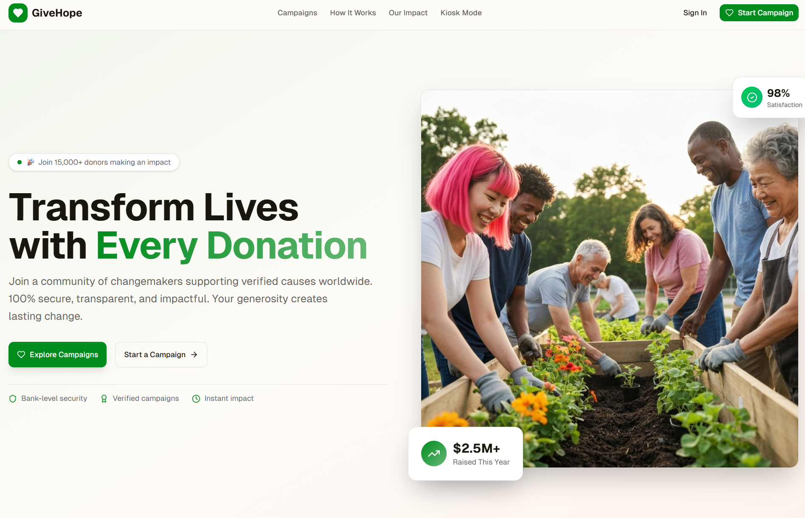

<div align="center">
  
  
  # HopeCircle Donation Portal
  
  **Transform Lives with Every Donation**
  
  A modern, secure, and transparent donation platform built with Next.js, featuring campaign management, multiple payment methods, and kiosk mode for public donations.
  
  [](https://nextjs.org/)
  [](https://www.typescriptlang.org/)
  [](https://supabase.com/)
  [](https://tailwindcss.com/)
  
</div>

---

## 🌟 Features

### 💳 **Donation Features**
- **Multiple Payment Methods**: Support for Stripe, PayPal, and Square payments
- **Recurring Donations**: Set up monthly, quarterly, or yearly recurring contributions
- **Anonymous Donations**: Option to donate anonymously while still supporting causes
- **Custom Amounts**: Flexible donation amounts with preset options ($5, $25, $50, $100, $250, $500)
- **Donor Messages**: Personal messages to accompany donations
- **Tip Support**: Optional tips to support platform operations
- **Real-time Tracking**: Live progress tracking for all campaigns

### 🎯 **Campaign Management**
- **Campaign Creation**: Easy-to-use campaign setup with rich descriptions and images
- **Progress Tracking**: Visual progress bars and real-time statistics
- **Campaign Categories**: Organize campaigns by cause and category
- **Goal Setting**: Set and track fundraising goals with deadlines
- **Status Management**: Active, paused, completed, and archived campaign states
- **Organization Profiles**: Support for organization branding and logos

### 🏢 **Admin Dashboard**
- **Campaign Overview**: Comprehensive dashboard with key metrics and statistics
- **Donation Analytics**: Track donations, revenue, and donor engagement
- **Campaign Management**: Create, edit, and manage multiple campaigns
- **Donor Management**: View donor information and donation history
- **Financial Reports**: Track total raised amounts and campaign performance
- **User Authentication**: Secure login and user management

### 🖥️ **Kiosk Mode**
- **Public Donation Interface**: Touch-friendly interface for public spaces
- **Campaign Selection**: Browse and select from active campaigns
- **Simplified Flow**: Streamlined donation process optimized for kiosks
- **Large Touch Targets**: Designed for easy interaction on touch screens
- **Offline Capability**: Basic functionality without requiring user accounts

### 🔒 **Security & Trust**
- **Bank-Level Security**: 256-bit SSL encryption for all transactions
- **Payment Security**: Industry-leading encryption with Stripe, PayPal, and Square
- **Verified Campaigns**: All campaigns are vetted before going live
- **Transparent Tracking**: Real-time updates on campaign progress and fund usage
- **Privacy Protection**: Secure handling of donor information and payment data
- **Money-Back Guarantee**: Full refund policy for unverified campaigns

### 📱 **User Experience**
- **Responsive Design**: Mobile-first design that works on all devices
- **Dark/Light Mode**: Built-in theme switching for user preference
- **Accessibility**: WCAG compliant design with screen reader support
- **Fast Loading**: Optimized performance with Next.js and modern web technologies
- **SEO Optimized**: Search engine friendly with proper meta tags and structure
- **Analytics**: Built-in analytics tracking with Vercel Analytics

---

## 🛠️ Technology Stack

### **Frontend**
- **Framework**: Next.js 14.2.16 with App Router
- **Language**: TypeScript 5.0
- **Styling**: Tailwind CSS 4.1.9
- **UI Components**: Radix UI primitives with custom styling
- **Icons**: Lucide React
- **Forms**: React Hook Form with Zod validation
- **State Management**: React hooks and context

### **Backend & Database**
- **Database**: Supabase (PostgreSQL)
- **Authentication**: Supabase Auth
- **Real-time**: Supabase real-time subscriptions
- **Storage**: Supabase Storage for images and files

### **Payment Processing**
- **Stripe**: Primary payment processor
- **PayPal**: Alternative payment method
- **Square**: Additional payment option

### **Development Tools**
- **Package Manager**: pnpm
- **Linting**: ESLint
- **Type Checking**: TypeScript
- **CSS Processing**: PostCSS with Autoprefixer

---

## 🚀 Installation & Setup

### Prerequisites
- Node.js 18.0 or later
- pnpm (recommended) or npm
- Supabase account
- Stripe account (for payments)
- PayPal developer account (optional)
- Square developer account (optional)

### 1. Clone the Repository
```bash
git clone https://github.com/your-username/hopecircle.git
cd hopecircle
```

### 2. Install Dependencies
```bash
# Using pnpm (recommended)
pnpm install

# Or using npm
npm install
```

### 3. Environment Configuration
Create a `.env.local` file in the root directory:

```env
# Supabase Configuration
NEXT_PUBLIC_SUPABASE_URL=your_supabase_project_url
NEXT_PUBLIC_SUPABASE_ANON_KEY=your_supabase_anon_key
SUPABASE_SERVICE_ROLE_KEY=your_supabase_service_role_key

# Stripe Configuration
STRIPE_SECRET_KEY=your_stripe_secret_key
NEXT_PUBLIC_STRIPE_PUBLISHABLE_KEY=your_stripe_publishable_key
STRIPE_WEBHOOK_SECRET=your_stripe_webhook_secret

# PayPal Configuration (optional)
PAYPAL_CLIENT_ID=your_paypal_client_id
PAYPAL_CLIENT_SECRET=your_paypal_client_secret
NEXT_PUBLIC_PAYPAL_CLIENT_ID=your_paypal_client_id

# Square Configuration (optional)
SQUARE_APPLICATION_ID=your_square_application_id
SQUARE_APPLICATION_SECRET=your_square_application_secret
SQUARE_ENVIRONMENT=sandbox
```

### 4. Database Setup

#### Supabase Setup
1. Create a new Supabase project
2. Go to the SQL Editor in your Supabase dashboard
3. Run the SQL scripts in the `scripts/` directory in order:

```bash
# Run these in order:
scripts/001_create_campaigns_table.sql
scripts/002_create_donations_table.sql
scripts/003_create_recurring_subscriptions_table.sql
scripts/004_create_functions_and_triggers.sql
scripts/005_seed_sample_data.sql
```

#### Database Schema
The application uses the following main tables:
- **campaigns**: Stores campaign information
- **donations**: Records all donation transactions
- **recurring_subscriptions**: Manages recurring donation subscriptions

### 5. Payment Provider Setup

#### Stripe Setup
1. Create a Stripe account and get your API keys
2. Set up webhooks pointing to `/api/webhooks/stripe`
3. Configure webhook events: `payment_intent.succeeded`, `payment_intent.payment_failed`

#### PayPal Setup (Optional)
1. Create a PayPal developer account
2. Create a new application and get your client ID and secret
3. Configure the PayPal SDK in your application

#### Square Setup (Optional)
1. Create a Square developer account
2. Create a new application and get your application ID and secret
3. Configure the Square SDK in your application

### 6. Development Server
```bash
# Start the development server
pnpm dev

# Or using npm
npm run dev
```

Open [http://localhost:3000](http://localhost:3000) to view the application.

### 7. Production Build
```bash
# Build for production
pnpm build

# Start production server
pnpm start
```

---

## 📁 Project Structure

```
hopecircle/
├── app/                          # Next.js App Router
│   ├── admin/                   # Admin dashboard pages
│   │   ├── campaigns/          # Campaign management
│   │   └── page.tsx            # Admin dashboard
│   ├── api/                    # API routes
│   │   ├── capture-paypal-order/
│   │   ├── create-payment-intent/
│   │   ├── create-paypal-order/
│   │   ├── create-square-payment/
│   │   └── webhooks/           # Payment webhooks
│   ├── auth/                   # Authentication pages
│   │   ├── login/
│   │   ├── signup/
│   │   └── verify-email/
│   ├── campaign/               # Public campaign pages
│   ├── donate/                 # Donation flow pages
│   ├── kiosk/                  # Kiosk mode pages
│   ├── donation-success/       # Success page
│   ├── globals.css             # Global styles
│   ├── layout.tsx              # Root layout
│   └── page.tsx                # Homepage
├── components/                 # React components
│   ├── ui/                    # Reusable UI components
│   ├── admin-campaign-list.tsx
│   ├── campaign-*.tsx         # Campaign-related components
│   ├── donation-*.tsx         # Donation-related components
│   ├── kiosk-*.tsx            # Kiosk mode components
│   └── site-*.tsx             # Site-wide components
├── hooks/                     # Custom React hooks
├── lib/                       # Utility libraries
│   ├── supabase/             # Supabase client configuration
│   ├── stripe.ts             # Stripe configuration
│   ├── types.ts              # TypeScript type definitions
│   └── utils.ts              # Utility functions
├── scripts/                   # Database setup scripts
├── public/                    # Static assets
├── styles/                    # Additional styles
├── middleware.ts              # Next.js middleware
├── next.config.mjs            # Next.js configuration
├── package.json               # Dependencies and scripts
└── tsconfig.json              # TypeScript configuration
```

---

## 🔧 Configuration

### Environment Variables
All configuration is done through environment variables. See the installation section for the complete list of required variables.

### Customization
- **Branding**: Update the logo and colors in `public/` and `globals.css`
- **Payment Methods**: Enable/disable payment methods by commenting out the relevant code
- **Features**: Toggle features by modifying the component logic
- **Styling**: Customize the appearance using Tailwind CSS classes

---

## 📊 Key Features in Detail

### Donation Flow
1. **Campaign Selection**: Browse featured and active campaigns
2. **Amount Selection**: Choose from preset amounts or enter custom amount
3. **Donor Information**: Optional donor details and anonymous option
4. **Payment Processing**: Secure payment through chosen provider
5. **Confirmation**: Real-time confirmation and receipt generation

### Admin Dashboard
- **Campaign Overview**: Visual dashboard with key metrics
- **Donation Tracking**: Real-time donation monitoring
- **Campaign Management**: Create, edit, and manage campaigns
- **Financial Reports**: Revenue tracking and analytics
- **User Management**: Donor information and history

### Kiosk Mode
- **Touch Interface**: Optimized for touch screen interaction
- **Campaign Browser**: Large, easy-to-navigate campaign selection
- **Simplified Flow**: Streamlined donation process
- **Public Access**: No account required for donations

---

## 🤝 Contributing

We welcome contributions! Please follow these steps:

1. Fork the repository
2. Create a feature branch (`git checkout -b feature/amazing-feature`)
3. Commit your changes (`git commit -m 'Add some amazing feature'`)
4. Push to the branch (`git push origin feature/amazing-feature`)
5. Open a Pull Request

### Development Guidelines
- Follow the existing code style and patterns
- Write tests for new features
- Update documentation as needed
- Ensure all checks pass before submitting

---

## 📄 License

This project is licensed under the MIT License - see the [LICENSE](LICENSE) file for details.

---

## 🆘 Support & Help

### Documentation
- [Next.js Documentation](https://nextjs.org/docs)
- [Supabase Documentation](https://supabase.com/docs)
- [Stripe Documentation](https://stripe.com/docs)
- [Tailwind CSS Documentation](https://tailwindcss.com/docs)

### Getting Help
- Create an issue for bug reports
- Start a discussion for questions
- Check existing issues and discussions

### Security
- Report security vulnerabilities privately to security@hopecircle.com
- Follow responsible disclosure practices

---

## 🎯 Roadmap

### Upcoming Features
- [ ] Mobile app (React Native)
- [ ] Advanced analytics dashboard
- [ ] Multi-language support
- [ ] Social media integration
- [ ] Email marketing integration
- [ ] Advanced reporting tools
- [ ] API for third-party integrations

### Known Issues
- See the [Issues](https://github.com/your-username/hopecircle/issues) page for current known issues and their status.

---

<div align="center">
  
**Made with ❤️ for making the world a better place**

</div>
